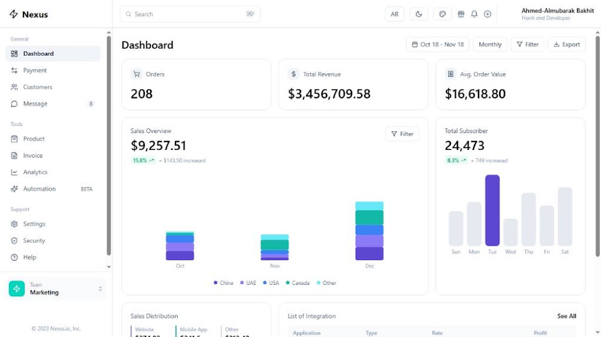

# 📊 Nexus Dashboard — Modern SaaS Analytics Admin Panel

A responsive, customizable SaaS analytics dashboard built with **React**, **TypeScript (Strict Mode)**, **Vite**, **Tailwind CSS v4**, and **Recharts**.

🔗 **Live Demo:** [nexus-dashboard-jet.vercel.app](https://vercel.app)



---

## ✨ Key Features

- **Interactive Data Visualizations (`Recharts`):** Dynamic, responsive charts for Sales Overview, Subscriber Growth, and Distribution metrics.
- **KPI Stats & Integrations Table:** Real-time summary stat cards with status badges and structured integration data tables.
- **Live UI Customizer & Persistence:** Built-in `CustomizerMenu` powered by `SettingsProvider` and `usePersistedState` to save theme and layout preferences across sessions.
- **Bilingual Support (i18n):** Seamless multi-language switching via a dedicated translation system (`translations.ts`).
- **Clean Architecture & Custom Hooks:** Modular codebase featuring reusable custom hooks (`useAsync`, `usePersistedState`, `useDismiss`) and a decoupled API service layer (`src/api`).

---

## 🛠️ Tech Stack

- **Framework & Build Tool:** React 18 + Vite
- **Language:** TypeScript (Strict Mode)
- **Styling:** Tailwind CSS v4 (`@tailwindcss/vite`)
- **Data Visualization:** Recharts
- **Icons:** Lucide React
- **Deployment:** Vercel

---

## 📂 Project Structure

```text
src/
├── api/            # Decoupled HTTP client & orders service layer
├── components/     # Modular UI (Charts, Stats, Integrations, Sidebar, Header)
├── config/         # Application & user configuration
├── context/        # Global settings provider & hooks
├── data/           # Structured mock datasets
├── hooks/          # Custom reusable hooks (useAsync, usePersistedState, useDismiss)
├── i18n/           # Internationalization & translation files
└── utils/          # Formatting helpers
```

---

## 🚀 Getting Started Locally

1. **Clone the repository:**
   ```bash
   git clone https://github.com
   cd nexus-dashboard
   ```

2. **Install dependencies:**
   ```bash
   npm install
   ```

3. **Run the development server:**
   ```bash
   npm run dev
   ```

---

## 👨‍💻 Author

**Ahmed Almubarak Bakhit**  
- GitHub: [@AhmadBakhit2000](https://github.com/AhmadBakhit2000)  
- LinkedIn: [Ahmed Almubarak Bakhit](https://www.linkedin.com/in/ahmed-alumbarak-bakhit/)
